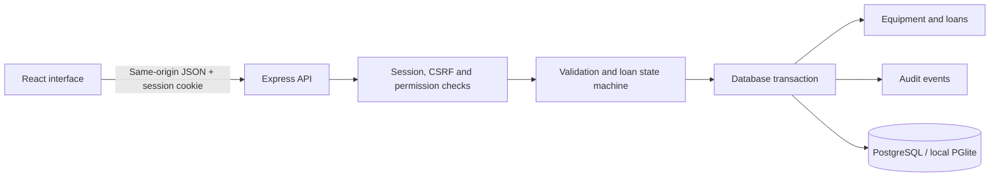
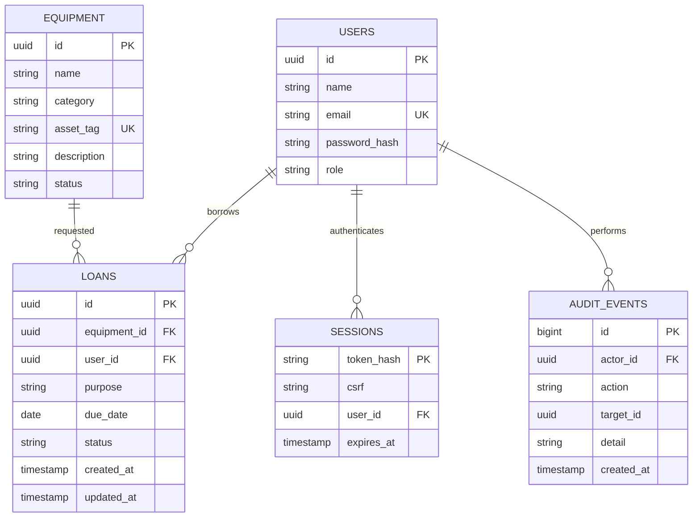
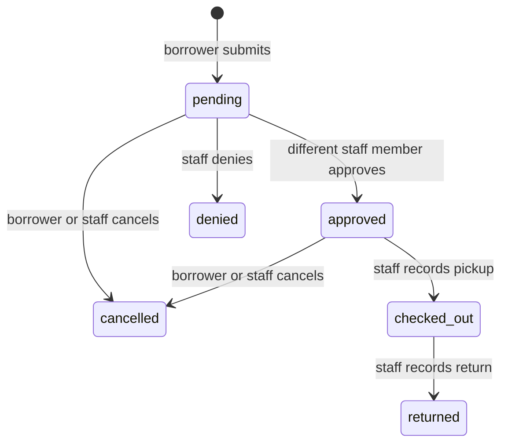

# Architecture

## Request flow

Development uses Vite middleware in the Express process, so browser traffic has one origin. Production serves the Vite build from Express. No CORS policy opens API access to other websites.

`server/db.ts` adapts `pg.Pool` or PGlite to the same parameterized query interface. PostgreSQL transactions use a dedicated pool connection and explicit commit/rollback. PGlite serializes all database operations around its single connection, including complete transactions. The PostgreSQL row-lock path is verified separately by CI.

## Data model

Each equipment record represents **one physical item**, identified by a unique asset tag. There is no quantity counter to accidentally decrement twice. A partial unique index permits at most one approved or checked-out loan per asset. `target_id` in audit events is intentionally polymorphic and is not a foreign key.

## Permission matrix

| Operation                                        | Student | Staff | Administrator |
| ------------------------------------------------ | ------- | ----- | ------------- |
| Browse equipment / submit own request            | Yes     | Yes   | Yes           |
| Read own requests                                | Yes     | Yes   | Yes           |
| Read all requests and audit log                  | No      | Yes   | Yes           |
| Cancel own pending/approved request              | Yes     | Yes   | Yes           |
| Cancel another person's pending/approved request | No      | Yes   | Yes           |
| Approve / deny / record pickup and return        | No      | Yes   | Yes           |
| Approve own request                              | No      | No    | No            |
| Create inventory / toggle maintenance            | No      | No    | Yes           |

Unknown and unauthorized loan IDs both return 404 to students. The UI hides inaccessible controls, while the API independently enforces permissions.

## State transitions

Approval locks both the loan and physical asset, checks that the asset is available, reserves it, changes the loan status, and inserts the audit event in the same transaction. A losing concurrent approval returns 409 without creating a misleading audit event. Cancellation of an approved request and recorded return release equipment. Pending requests are a queue of interest and do not promise a reservation. No future date-range reservations are implemented.

## API

All protected endpoints require an unexpired cookie session. All writes additionally require `Origin` equal to `APP_ORIGIN` and the session's `X-CSRF-Token`. Call `GET /api/session` first to bootstrap the session and CSRF token.

| Method | Path                  | Purpose                                 |
| ------ | --------------------- | --------------------------------------- |
| GET    | /api/health           | Liveness, no private data               |
| GET    | /api/session          | Current user, CSRF token, demo flag     |
| POST   | /api/login            | Authenticate and rotate session         |
| POST   | /api/logout           | Revoke session                          |
| GET    | /api/equipment        | Catalog                                 |
| POST   | /api/equipment        | Create an inventory record (admin)      |
| PATCH  | /api/equipment/:id    | Set available/maintenance (admin)       |
| GET    | /api/loans            | Own requests, or all for staff          |
| GET    | /api/loans/:id        | Read an authorized request              |
| POST   | /api/loans            | Submit a request                        |
| POST   | /api/loans/:id/action | approve, deny, checkout, return, cancel |
| GET    | /api/audit            | Latest 200 events (staff/admin)         |

Error responses use `{ "error": "message" }`. Input errors return 400, authentication failures 401, forbidden actions 403, unknown/inaccessible requests 404, conflicts 409, and login throttling 429. Query text is fixed SQL; inputs are passed separately as parameters.

## Source map

- `server/app.ts`: middleware, API validation, authorization, and transactional workflows.
- `server/auth.ts`: scrypt password hashing and random session-token helpers.
- `server/db.ts`: adapters and initial schema migration.
- `server/seed.ts`: explicit local demonstration data.
- `server/index.ts`: configuration guards and HTTP server.
- `src/main.tsx`: role-aware React interface and API calls.
- `src/styles.css`: responsive visual design and keyboard focus styling.
- `tests/security.test.ts`: API and data-integrity tests.
- `tests/browser/workflows.spec.ts`: browser workflows and automated accessibility checks.
