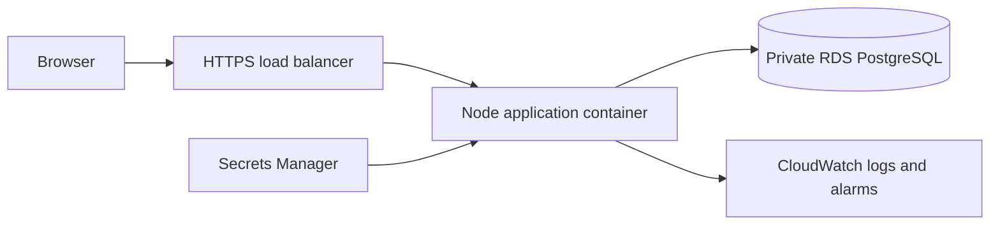

# Deployment guide

The completed repository runs locally and includes CI. Publishing its source to GitHub does **not** deploy the API. GitHub Pages cannot run this Express backend. The AWS topology below is a future design; no cloud resources are provisioned by this project.

## Production configuration

Use Node.js 24+, PostgreSQL, and an HTTPS reverse proxy/load balancer. Use a clean production database; do not reuse the seeded demo database.

```text
NODE_ENV=production
DEMO_MODE=false
APP_ORIGIN=https://your-actual-domain.example
DATABASE_URL=<connection string from your secrets manager>
PGSSL=true
HOST=0.0.0.0
PORT=3000
```

`PGSSL=true` enables certificate validation. Install the database provider's trusted CA if it is not in the Node runtime's trust store. Never work around certificate errors by disabling validation. TLS may be omitted only for an isolated local development database.

```text
npm ci
npm run build
npm start
```

The current start command uses `tsx`; keep development dependencies installed with `npm ci` for this version. A future production build can emit server JavaScript and remove the need for TypeScript execution tooling.

Startup validates production settings and rejects known demo account addresses. It creates missing application tables but is not a versioned migration tool. Run schema setup once with a migration identity before scaling, then grant the runtime database identity only the permissions it needs. Production startup expects the existing tables to be readable and the idempotent schema statements to be permitted or moved to your migration process.

Create initial users using the operator-only `npm run user:create` script. Set `NEW_USER_EMAIL`, `NEW_USER_NAME`, `NEW_USER_ROLE` (`student`, `staff`, or `admin`) and `NEW_USER_PASSWORD` in the process environment. The password must be at least 14 characters. Read it securely from an interactive prompt or secret store, never a literal shell argument, checked-in file, or CI log. Remove it from the environment when finished. There is no browser-facing user provisioning endpoint.

## Proposed AWS topology



Before a real deployment, implement shared login rate limiting, edge request limits, a precise trusted-proxy configuration, monitoring, backups and restore drills, retention rules, versioned migrations, and an identity provider integration. Review the [security limits](../SECURITY.md).

## Health and data

`GET /api/health` reports process liveness. It does not verify database readiness or backup health. Add a separate database readiness probe for orchestrated deployment.

Embedded local records live in `.data/campus`. Back up local records only while the process is stopped. For production, use PostgreSQL backup tooling and test restoration. Source control excludes `.env`, local records, dependencies, browser traces, and build output.
